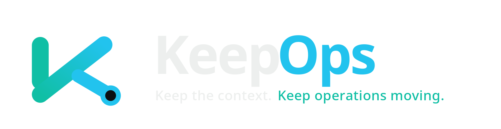
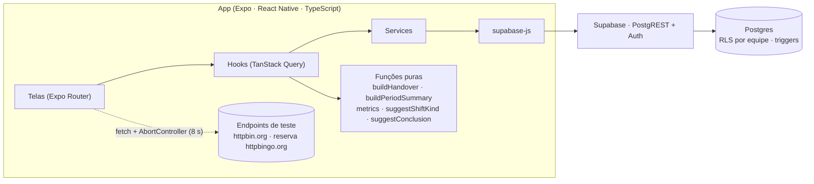

<p align="center">
  
</p>

<p align="center"><b>Keep the context. Keep operations moving.</b></p>

O **KeepOps** é o caderno de validação digital do plantonista que acompanha mudanças de infraestrutura (GMUDs) fora do horário comercial — madrugadas e fins de semana — e garante que o próximo turno e a equipe da semana assumam o que ficou pendente.

> Projeto acadêmico (AT2-N2 · React Native · UCB) e de portfólio SRE/DevOps. **Todos os dados são fictícios e demonstrativos.** O KeepOps não integra com ServiceNow/Jira: números de CHG/INC são apenas texto.

## O problema
Mudanças em sistemas críticos acontecem em janelas de baixo impacto. Um plantonista, sozinho, espera o executor liberar, valida as aplicações à mão, aciona o fornecedor quando algo falha e anota tudo em chats e planilhas. No dia seguinte (ou na segunda-feira, depois de várias GMUDs no fim de semana), o próximo turno e a equipe de sustentação precisam reconstruir o que aconteceu a partir de fragmentos.

## O que o app faz
| Fluxo | Recursos |
|---|---|
| **Turno → turno** | Início adaptado ao turno · GMUDs com checklist gerado do roteiro de cada aplicação · validação por passo (Aprovado/Reprovado/N/A) com autor e horário · **health check HTTP real** baseline × pós-mudança · ocorrência aberta a partir do passo reprovado · acionamentos com tempo sem resposta · **passagem de plantão gerada automaticamente** e compartilhável · confirmação de recebimento |
| **Plantão → equipe da semana** | **Resumo do período** (último fim de semana / últimas 24h) agrupado por turno · pendências que atravessam turnos, com **Assumir** e conclusão com nota · **métricas inspiradas em DORA/SRE** (taxa de falha de mudanças e MTTR, semana × fim de semana) |

## Arquitetura



- **Tela → hook → service → Supabase.** Telas nunca chamam o banco direto.
- **Regras de negócio em funções puras testadas** (`src/utils`): passagem, resumo do período, tipo de turno, métricas, resultado sugerido, health check.
- **Segurança no banco:** RLS em todas as tabelas (cada usuário só vê a própria equipe); sessão no Keychain/Keystore (`expo-secure-store`).
- **Triggers:** vincular uma aplicação à GMUD cria o checklist a partir do roteiro; toda mudança de status entra no histórico (`change_events`) que alimenta a linha do tempo.
- **Datas** em UTC no banco e exibidas em `America/Sao_Paulo`; "fim de semana" inclui feriados nacionais.

### Decisões registradas
| Decisão | Motivo |
|---|---|
| Passagem e resumo são **derivados**, não digitados | Ninguém reescreve o turno; o snapshot da passagem é congelado ao encerrar |
| Pendência é a **única entidade que atravessa turnos** | Continuidade explícita, com responsável e nota de conclusão obrigatória |
| Health check roda **no celular** | Prova de validação no momento; a Fase 2 leva isso para uma Edge Function agendada |
| Atualização **otimista** nos passos e no "Assumir" | Resposta instantânea para quem valida às 3h da manhã com uma mão |

## Stack
Expo SDK 58 · React Native 0.88 · TypeScript strict · Expo Router · Supabase (Postgres, Auth, RLS) · TanStack Query v5 · Zustand · react-hook-form + zod · date-fns · lucide-react-native · Geist / Geist Mono · Jest (jest-expo) · ESLint + Prettier

## Como rodar
1. `npm install`
2. Copie `.env.example` para `.env.local` e preencha com as chaves do seu projeto Supabase.
3. No Supabase, abra **SQL Editor** e execute, em ordem, os arquivos de `supabase/migrations/`.
4. `npm run seed` — cria a equipe demo, os usuários e os dados de exemplo (horários relativos ao momento em que roda).
5. `npx expo start` e abra no Expo Go.

### Usuários demonstrativos
| Usuário | E-mail | Papel |
|---|---|---|
| Ana Souza | ana.souza@example.com | Plantonista |
| João Lima | joao.lima@example.com | Plantonista |
| Marina Costa | marina.costa@example.com | Equipe da semana |

Senha de todos: `KeepOps#Demo2026` (ambiente demonstrativo). A tela de login tem atalhos "Entrar como".

### Windows
O Jest 30 usa um resolvedor nativo (`unrs-resolver`) que depende do **Microsoft Visual C++ Redistributable (x64)**.
Em um Windows recém-instalado, `npm test` falha com *"Preset jest-expo not found"*. Instale o runtime:
`winget install Microsoft.VCRedist.2015+.x64` (ou baixe em https://aka.ms/vs/17/release/vc_redist.x64.exe).

## Scripts
- `npm run check` — typecheck + lint + testes
- `npm test` — testes unitários (Jest)
- `npm run seed` — recria os dados demonstrativos
- `npm run format` — Prettier

## Estrutura
```
src/
  app/            rotas (Expo Router): (auth), (tabs), changes, incidents, follow-ups, shifts, metrics
  components/     ui/ (design system) e domain/ (StatusBadge, HandoverView, ValidationStepRow...)
  hooks/          TanStack Query por entidade
  services/       acesso a dados (Supabase)
  utils/          regras de negócio puras + testes em __tests__/
  theme/          tokens de cor, espaçamento e tipografia
supabase/
  migrations/     schema, RLS, triggers
scripts/seed.mjs  dados demonstrativos
```

## Roadmap (Fase 2)
GitHub Actions (lint, typecheck e testes em todo PR) · migrations por pipeline (Supabase CLI) · Edge Function agendada para health checks e ambiente simulado com falhas controláveis · push para o próximo plantonista · resumo do fim de semana automático às segundas 8h · webhook para Slack/Teams · Sentry · foto de evidência · período personalizado · edição de roteiros pelo app.

## Documentação
- [Especificação](docs/SPEC.md) · [Identidade visual](docs/IDENTIDADE_VISUAL.md) · [Progresso](docs/PROGRESSO.md) · [Roteiro do vídeo e da apresentação](docs/ROTEIRO.md)

---
© 2026 Sara Cristina Barros de Oliveira — **todos os direitos reservados**. Código visível para avaliação e portfólio; cópia, redistribuição ou uso sem autorização não são permitidos. Veja [LICENSE](LICENSE).
