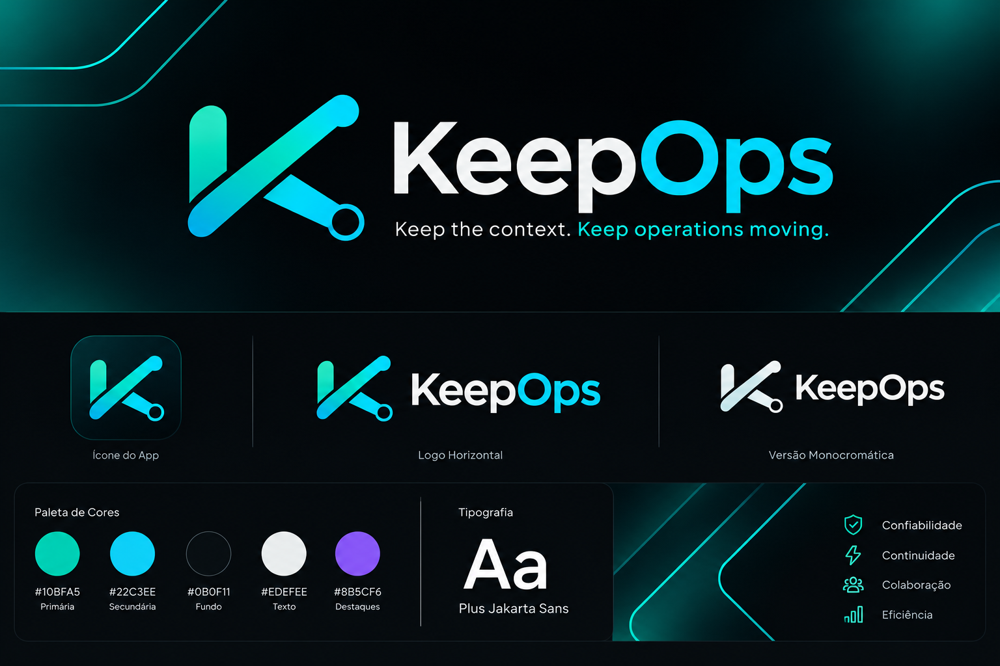
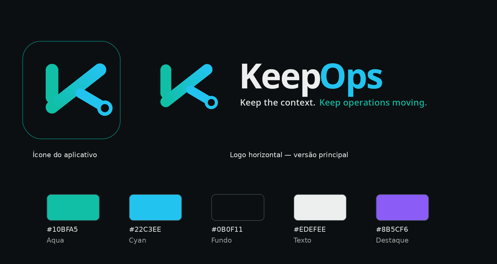
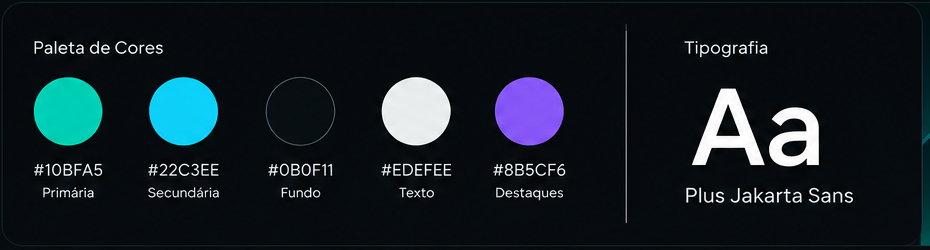

# KEEPOPS — IDENTIDADE VISUAL E GUIA DE IMPLEMENTAÇÃO

**Documento complementar à especificação principal do projeto**  
**Objetivo:** orientar a implementação visual do KeepOps no aplicativo mobile, sem alterar produto, escopo funcional, arquitetura ou regras de negócio.

> **Instrução prioritária para a IA de desenvolvimento:** a prancha visual anexada foi aprovada pela responsável pelo projeto. Use-a como referência visual principal. Este documento formaliza suas cores, logotipo, tipografia, componentes e aplicações. Não crie uma nova marca, não proponha outro nome e não reabra decisões de posicionamento.

---

## 1. O QUE ESTE DOCUMENTO ALTERA — E O QUE NÃO ALTERA

Este documento atualiza somente a identidade visual e a camada de apresentação do projeto.

### Alterações autorizadas

- Nome exibido no produto: **KeepOps**.
- Slogan: **Keep the context. Keep operations moving.**
- Logotipo e símbolo conforme os arquivos de `assets/`.
- Paleta de marca verde-água + ciano, fundo quase preto e roxo reservado para destaques pontuais.
- Tokens visuais de tema escuro e tema claro.
- Aplicação da identidade em splash screen, login, cabeçalho, navegação, cards, botões, badges e estados visuais.

### O que permanece exatamente como na especificação principal

- Problema atendido, proposta de valor, personas e fluxos de uso.
- Funcionalidades, telas, navegação e escopo MVP.
- Arquitetura, stack, dependências, banco de dados, Supabase, regras de negócio e critérios de aceite.
- Idioma da interface: português do Brasil.
- Estrutura de navegação com as cinco abas: Início, GMUDs, Ocorrências, Pendências e Plantões.
- Princípio de que todo botão executa uma ação real.

**Não simplifique nem remova funcionalidades para acomodar a identidade visual.** O objetivo é aplicar uma camada visual consistente ao produto já especificado.

---

## 2. REFERÊNCIA VISUAL APROVADA

A imagem abaixo é a referência principal escolhida. Preserve a composição visual, o contraste, a relação entre o símbolo e o wordmark e a família cromática.



Resumo dos elementos centrais:

- Símbolo geométrico que combina a letra **K** com traços conectados e um ponto terminal circular.
- `Keep` em branco suave e `Ops` em ciano.
- Símbolo com transição verde-água para ciano.
- Fundo quase preto.
- Slogan abaixo do wordmark, com a primeira frase em branco e a segunda em verde-água.
- Linhas curvas e paralelas como grafismo secundário, usadas com moderação em materiais institucionais e na splash screen.



### 2.1 Interpretação do símbolo

O símbolo é um **K estilizado e conectado**. Ele deve comunicar, de maneira abstrata:

- Continuidade entre turnos.
- Transferência de contexto entre responsáveis.
- Conexão entre atividades e equipes.
- Movimento operacional sem interrupção.

Não acrescente engrenagens, nuvens, servidores, computadores, escudos ou outros símbolos genéricos ao logotipo. O símbolo aprovado já deve funcionar sozinho.

---

## 3. ARQUIVOS DE MARCA DISPONÍVEIS

Os arquivos finais e de referência estão em `assets/`.

| Arquivo | Uso |
|---|---|
| `keepops-app-icon.png` | Ícone do aplicativo, 1024 × 1024 px |
| `keepops-app-icon.svg` | Master vetorial do ícone |
| `keepops-symbol-color.png` | Símbolo colorido com fundo transparente |
| `keepops-symbol-color.svg` | Master vetorial do símbolo |
| `keepops-logo-horizontal-dark.png` | Logo horizontal para fundos escuros |
| `keepops-logo-horizontal-dark.svg` | Master vetorial da logo horizontal escura |
| `keepops-logo-horizontal-light.png` | Logo horizontal para fundos claros |
| `keepops-logo-horizontal-light.svg` | Master vetorial da logo horizontal clara |
| `keepops-logo-stacked-dark.png` | Versão vertical para splash e materiais institucionais |
| `keepops-logo-stacked-dark.svg` | Master vetorial da versão vertical |
| `keepops-logo-monochrome-dark.png` | Versão monocromática para fundos escuros |
| `keepops-logo-monochrome-dark.svg` | Master vetorial monocromático |
| `keepops-brand-board-referencia.png` | Prancha visual original aprovada |
| `keepops-logo-principal-referencia.png` | Recorte da logo apresentada na prancha |
| `keepops-logo-horizontal-referencia.png` | Recorte da versão horizontal original |
| `keepops-logo-monocromatico-referencia.png` | Recorte da versão monocromática original |
| `keepops-app-icon-referencia.png` | Recorte do ícone original apresentado na prancha |
| `keepops-paleta-tipografia-referencia.png` | Recorte da paleta e referência tipográfica |

**Nota sobre os arquivos SVG:** os SVGs foram reconstruídos vetorialmente a partir da prancha aprovada para viabilizar a implementação. A prancha original continua sendo a referência visual de fidelidade. Não altere o desenho do símbolo sem necessidade; se houver pequena diferença entre a reconstrução vetorial e a prancha, priorize a aparência da prancha.

### 3.1 Regras de uso da logo

- Usar a versão horizontal em telas de login, cabeçalhos institucionais e materiais de apresentação.
- Usar somente o símbolo no ícone do aplicativo e em espaços pequenos.
- Usar a versão escura em fundos `#0B0F11` ou superfícies escuras.
- Usar a versão clara em fundos brancos ou muito claros.
- Usar a versão monocromática apenas quando a aplicação exigir uma única cor.
- Não esticar, inclinar, redesenhar, contornar ou aplicar sombras à logo.
- Não trocar a ordem das cores: símbolo verde-água/ciano; `Keep` branco ou escuro conforme o fundo; `Ops` ciano na versão escura.
- Não escrever o slogan dentro de componentes pequenos, tab bar, badges ou ícone do aplicativo.
- Manter área livre ao redor do símbolo equivalente, no mínimo, à espessura visual de uma das hastes do K.

### 3.2 Gradiente: uso restrito

O gradiente verde-água → ciano pertence ao símbolo da marca. Ele pode aparecer nos arquivos oficiais da logo e em elementos institucionais de destaque.

**Não utilizar gradientes como preenchimento padrão de cards, botões, fundos de tela, badges ou gráficos de dados.** A interface do aplicativo deve continuar predominantemente sólida, limpa e funcional.

---

## 4. SISTEMA DE CORES

### 4.1 Cores de marca

| Token sugerido | Cor | HEX | Uso |
|---|---|---|---|
| `brandPrimary` | Aqua | `#10BFA5` | Cor principal da marca, CTAs e elementos ativos |
| `brandSecondary` | Electric Cyan | `#22C3EE` | Complemento do símbolo, detalhes e elementos secundários |
| `brandHighlight` | Violet | `#8B5CF6` | Destaque raro em materiais institucionais; não usar como cor funcional |
| `bg` | Deep Black | `#0B0F11` | Fundo principal do tema escuro |
| `text` | Soft White | `#EDEFEE` | Texto principal no tema escuro |



### 4.2 Tokens — tema escuro (principal)

Usar estes valores como base em `src/theme/colors.ts`. Eles substituem os valores antigos da paleta Terminal quando houver divergência.

```ts
export const darkColors = {
  // Base
  bg: '#0B0F11',
  surface: '#111719',
  surface2: '#1A2427',
  border: 'rgba(237, 239, 238, 0.08)',
  borderHi: 'rgba(237, 239, 238, 0.16)',

  // Texto
  text: '#EDEFEE',
  muted: '#9BA3A0',
  dim: '#68716D',

  // Marca
  brandPrimary: '#10BFA5',
  brandPrimaryText: '#5DE2C7',
  brandPrimarySoft: 'rgba(16, 191, 165, 0.14)',
  brandSecondary: '#22C3EE',
  brandSecondaryText: '#7DDCF4',
  brandSecondarySoft: 'rgba(34, 195, 238, 0.13)',
  brandHighlight: '#8B5CF6',

  // Estados funcionais — não confundir com as cores da marca
  ok: '#22C55E',
  okText: '#86EFAC',
  okSoft: 'rgba(34, 197, 94, 0.14)',
  warn: '#F59E0B',
  warnText: '#FCD34D',
  warnSoft: 'rgba(245, 158, 11, 0.14)',
  bad: '#F43F5E',
  badText: '#FDA4AF',
  badSoft: 'rgba(244, 63, 94, 0.14)',
  info: '#3B82F6',
  infoText: '#93C5FD',
  infoSoft: 'rgba(59, 130, 246, 0.14)',
  neutral: '#64748B',
  neutralText: '#CBD5E1',
  neutralSoft: 'rgba(100, 116, 139, 0.14)',
} as const;
```

**Importante:** o Aqua `#10BFA5` é cor de identidade e ação da interface. Sucesso/aprovado/resolvido deve usar o verde funcional `#22C55E`, com ícone e rótulo próprios. Isso evita que a cor da marca seja interpretada como resultado de validação.

### 4.3 Tokens — tema claro (secundário)

A identidade deve continuar reconhecível no tema claro. Não reutilizar os valores claros do tema escuro para textos sobre branco: aqua e ciano originais são cores de marca, mas não têm contraste suficiente para textos pequenos em fundo branco.

```ts
export const lightColors = {
  bg: '#F5F8F7',
  surface: '#FFFFFF',
  surface2: '#EDF3F1',
  border: 'rgba(11, 15, 17, 0.10)',
  borderHi: 'rgba(11, 15, 17, 0.18)',

  text: '#0B0F11',
  muted: '#52615C',
  dim: '#74817D',

  // Tons escurecidos para textos/ícones sobre fundo claro
  brandPrimary: '#087A70',
  brandPrimaryText: '#087A70',
  brandPrimarySoft: 'rgba(8, 122, 112, 0.10)',
  brandSecondary: '#0B7590',
  brandSecondaryText: '#0B7590',
  brandSecondarySoft: 'rgba(11, 117, 144, 0.10)',
  brandHighlight: '#7C3AED',

  // Estados funcionais
  ok: '#15803D',
  okText: '#166534',
  okSoft: 'rgba(21, 128, 61, 0.10)',
  warn: '#B45309',
  warnText: '#92400E',
  warnSoft: 'rgba(180, 83, 9, 0.10)',
  bad: '#E11D48',
  badText: '#9F1239',
  badSoft: 'rgba(225, 29, 72, 0.10)',
  info: '#2563EB',
  infoText: '#1D4ED8',
  infoSoft: 'rgba(37, 99, 235, 0.10)',
  neutral: '#64748B',
  neutralText: '#475569',
  neutralSoft: 'rgba(100, 116, 139, 0.10)',
} as const;
```

### 4.4 Semântica de cores

| Significado | Cor a usar | Exemplo |
|---|---|---|
| Identidade / ação principal | Aqua | Botão primário, aba ativa, links principais |
| Complemento de marca | Ciano | Símbolo, pequenos detalhes e apoio visual |
| Sucesso | Verde funcional | Aprovada, validada, resolvida |
| Atenção | Âmbar | Pendente, aguardando, com ressalvas, acionamento sem resposta |
| Erro / crítico | Vermelho | Reprovada, indisponível, SEV1/SEV2 |
| Informação | Azul | Em validação, status informativo |
| Neutro | Cinza | Agendada, N/A, cancelada |
| Destaque editorial pontual | Violeta | Material institucional; não representa status operacional |

Nunca comunicar status apenas com cor. Sempre combinar **cor + ícone + texto**.

---

## 5. TIPOGRAFIA

A especificação original já prevê **Geist** e **Geist Mono**. Manter essas fontes na implementação para respeitar a stack aprovada e não adicionar dependências sem autorização.

A prancha usa uma referência tipográfica geométrica semelhante à Plus Jakarta Sans. Na interface React Native, reproduzir essa sensação usando Geist, já prevista no projeto. Não instalar uma nova família tipográfica por conta própria.

### 5.1 Uso

- `Geist`: títulos, textos, botões, navegação, labels e wordmark quando renderizado como texto.
- `Geist Mono`: números de GMUD/INC, horários, latências, cronômetros, métricas e identificadores técnicos.

### 5.2 Hierarquia

| Uso | Tamanho | Peso |
|---|---:|---|
| Título principal / saudação | 24–30 | 600 |
| Título de card | 16 | 600 |
| Corpo | 14–15 | 400 |
| Título de seção | 13 | 600, caixa alta, letter-spacing discreto |
| Metadados | 12 | 400–500 |
| Tab bar | 11 | 500 |
| Dados técnicos | 12–16 | Geist Mono, conforme destaque |

Manter line-height confortável e não reduzir textos funcionais para caber nos cards. Priorizar legibilidade em telas pequenas.

---

## 6. LINGUAGEM VISUAL E COMPONENTES

### 6.1 Linguagem visual

- Minimalista, técnica, organizada e precisa.
- Superfícies escuras sólidas, com bordas discretas.
- Cantos arredondados moderados, sem excesso de pílulas.
- Ícones lineares consistentes, usando `lucide-react-native`, já previsto na stack.
- Linhas paralelas curvas da prancha podem aparecer na splash screen ou em material institucional, com baixa opacidade.
- Evitar ilustrações decorativas que disputem atenção com informações operacionais.
- Não usar brilho neon, sombras fortes, glassmorphism ou gradientes em componentes funcionais.

### 6.2 Formas, bordas e espaçamento

Preservar a escala já definida no projeto:

- Chips e badges: radius 8.
- Botões e inputs: radius 12.
- Cards: radius 14–16.
- Espaçamento: múltiplos de 4 — 4, 8, 12, 16, 20, 24 e 28.
- Alvos de toque: mínimo 44 pt.
- Bordas discretas; usar `borderHi` apenas para foco ou ênfase necessária.

### 6.3 Botões

**Primário:** fundo `brandPrimary` (`#10BFA5`) e texto escuro `#042B26`. Não usar texto branco sobre Aqua: o texto escuro oferece contraste muito melhor.

**Secundário:** fundo transparente ou `surface2`, borda discreta e texto principal.

**Ghost:** sem preenchimento, texto `brandPrimaryText` e ícone quando necessário.

**Danger:** usar a cor funcional `bad`, não a cor da marca.

Não usar gradiente nos botões.

### 6.4 Cards

- Fundo `surface`.
- Borda `border`.
- Título em `text`.
- Metadados em `muted`.
- Números técnicos em Geist Mono.
- Indicadores de situação usam as cores funcionais.
- Não colorir o card inteiro para indicar status; preferir badge, ícone, ponto ou borda curta de apoio.

### 6.5 Badges e chips

Usar pares de fundo/texto (`okSoft` + `okText`, por exemplo). O ícone acompanha o rótulo. A cor Aqua não deve ser utilizada para representar “aprovado”.

### 6.6 Ícones

- Usar a biblioteca `lucide-react-native` já prevista.
- Preferir traço de 1.8–2 px, formas simples e consistentes.
- Tamanho padrão 20–22 px em navegação e listas; 16 px em metadados; 24 px em ações de destaque.
- Não misturar ícones preenchidos, 3D e outline sem uma regra clara.

---

## 7. APLICAÇÃO NAS TELAS DO KEEPOPS

A identidade deve ser aplicada às telas já previstas. Não alterar a arquitetura das telas nem inventar fluxos novos.

### 7.1 Splash screen

- Fundo `#0B0F11`.
- Logo vertical ou símbolo centralizado.
- Slogan abaixo da marca, em tamanho discreto.
- Linhas curvas da prancha podem aparecer nos cantos, com baixa opacidade.
- Não colocar indicadores, cards ou conteúdo operacional na splash.

### 7.2 Ícone do aplicativo

Usar `assets/keepops-app-icon.png` como ícone principal. O ícone contém somente o símbolo, em fundo escuro arredondado. Não adicionar wordmark, slogan ou badge `DEMO`.

### 7.3 Login

- Fundo escuro.
- Logo horizontal ou versão vertical, conforme a largura disponível.
- Slogan menor e secundário.
- Campos em superfície escura, borda discreta e foco em Aqua.
- Botão de entrada primário em Aqua com texto escuro.
- Atalhos de usuários demonstrativos claramente identificados, sem competir com o CTA principal.

### 7.4 Cabeçalho do aplicativo

- Símbolo KeepOps compacto à esquerda.
- Wordmark `KeepOps` em branco suave; se o espaço for limitado, usar apenas o símbolo.
- Selo `DEMO` separado da marca, com estilo neutro.
- Ação de Aplicações e avatar permanecem no lado direito, conforme a especificação original.
- Não colocar slogan no cabeçalho principal.

### 7.5 Início / Dashboard

- Manter a hierarquia de informações definida na especificação principal.
- Saudação e estado de turno em primeiro plano.
- Aqua apenas para ação principal, seleção e foco.
- Contadores e resultados de GMUD usam as cores semânticas.
- Pendências e acionamentos sem resposta devem continuar visualmente distintos.
- Cards neutros, com densidade de informação respirável.

### 7.6 Barra inferior de navegação

- Cinco abas originais: Início, GMUDs, Ocorrências, Pendências e Plantões.
- Ícones Lucide com 20 px.
- Aba ativa: `brandPrimaryText` no tema escuro e `brandPrimary` no tema claro.
- Abas inativas: `dim`.
- Rótulos curtos e sempre legíveis.

### 7.7 GMUDs, validações e health checks

- Número da GMUD e dados técnicos em Geist Mono.
- Resultado aprovado: verde funcional.
- Resultado reprovado: vermelho funcional.
- Em validação: azul informativo.
- Botão principal de ação pode usar Aqua.
- Não confundir botão de ação com resultado da validação.

### 7.8 Ocorrências e severidade

- Usar vermelho para severidades críticas e erros, com rótulo SEV e ícone.
- Âmbar para acionamentos aguardando resposta.
- Azul para informação ou andamento.
- A identidade Aqua não substitui as cores de severidade.

### 7.9 Pendências e passagem de plantão

- Pendências abertas: âmbar ou neutro, conforme o estado.
- Ação “Assumir”: botão secundário/outline.
- Estado “Com você”: estilo de confirmação discreto, sem transformar toda a tela em verde.
- Concluída: verde funcional.
- A passagem deve priorizar leitura rápida, títulos curtos, horários e responsáveis bem identificados.

### 7.10 Tema claro

Quando o tema claro for implementado, usar os tokens da seção 4.3. Manter o ícone oficial com fundo escuro. Usar a logo para fundo claro em superfícies brancas. Não simplesmente inverter as cores do tema escuro.

---

## 8. IMPLEMENTAÇÃO TÉCNICA DOS ASSETS

- Copiar os PNGs necessários para `assets/brand/` no projeto Expo.
- Usar `keepops-app-icon.png` como ícone do app.
- Usar PNGs transparentes para logo/símbolo em componentes React Native com `Image`.
- Os SVGs ficam como masters vetoriais e fonte de exportação. Não adicionar `react-native-svg-transformer` nem outra dependência apenas para importar SVG como componente.
- A stack original já prevê `react-native-svg`; caso a equipe opte por redesenhar o símbolo como componente nativo com essa biblioteca, fazê-lo sem adicionar dependências e mantendo fidelidade aos masters.
- Não usar a prancha completa como imagem de tela do aplicativo. Ela é referência de design, não um asset de interface.
- Não recriar o wordmark com texto se o PNG oficial puder ser usado no espaço disponível. Quando for necessário texto responsivo, usar Geist 700 e manter a distinção `Keep` / `Ops` conforme as cores do tema.

### Organização sugerida no projeto

```text
assets/
  brand/
    keepops-app-icon.png
    keepops-symbol-color.png
    keepops-logo-horizontal-dark.png
    keepops-logo-horizontal-light.png
    keepops-logo-stacked-dark.png
    keepops-logo-monochrome-dark.png
```

Os arquivos SVG e as pranchas de referência podem permanecer na pasta de documentação/branding, fora do bundle do app.

---

## 9. SUBSTITUIÇÕES NA ESPECIFICAÇÃO ORIGINAL

Ao aplicar este documento ao projeto existente:

1. Substituir toda ocorrência visível de `NexOps` por `KeepOps` em títulos, cabeçalhos, login, splash, metadados e documentação do produto.
2. Usar o slogan exatamente como definido neste documento.
3. Atualizar os tokens da antiga paleta Terminal pelos tokens da seção 4, preservando a semântica funcional dos estados.
4. Atualizar o cabeçalho e a splash para usar os novos arquivos da marca.
5. Preservar Geist e Geist Mono, componentes, dimensões, fluxos e navegação já definidos.
6. Não alterar nomes de tabelas, entidades, APIs ou regras de negócio por causa da mudança visual, salvo se ainda existir texto de marca exibido ao usuário.
7. Não introduzir bibliotecas, fontes ou dependências sem pedir autorização, conforme a regra da especificação principal.

---

## 10. CRITÉRIOS DE ACEITE VISUAL

- [ ] O nome KeepOps aparece corretamente em todas as superfícies visíveis.
- [ ] O slogan está escrito exatamente: `Keep the context. Keep operations moving.`
- [ ] O ícone do aplicativo usa somente o símbolo aprovado.
- [ ] A logo funciona em fundo escuro e claro.
- [ ] O tema escuro usa `#0B0F11` como fundo principal e Aqua/Cyan como cores de marca.
- [ ] O tema claro mantém contraste e usa as variações escuras das cores de marca para textos e ícones.
- [ ] Aqua representa marca/ação, não sucesso de validação.
- [ ] Verde, âmbar, vermelho, azul e cinza mantêm suas funções operacionais.
- [ ] Nenhum status depende apenas da cor: há ícone e texto.
- [ ] Não há gradientes em cards, botões ou badges.
- [ ] As telas continuam legíveis em dispositivos móveis e respeitam alvos de toque de pelo menos 44 pt.
- [ ] Nenhuma funcionalidade, tela ou fluxo original foi removido para acomodar o redesign.
- [ ] Nenhuma dependência nova foi adicionada sem autorização.

---

## 11. ORIENTAÇÃO FINAL PARA A IA DE DESENVOLVIMENTO

Implemente a identidade visual deste documento no projeto KeepOps existente. Faça a atualização visual de forma incremental, sem reescrever o aplicativo inteiro e sem alterar lógica que já funciona.

Antes de finalizar, confira todas as telas principais no tema escuro e verifique o contraste entre marca e estados operacionais. Se uma decisão de interface não estiver especificada, escolha a solução mais simples, legível e coerente com a prancha aprovada. Não crie uma nova proposta de branding.

---

## Ajuste de 20/11/2026 (aprovado pela responsável)

Feedback: as cores da interface "brigavam" com a logo. Toda a paleta do tema escuro passou a derivar da família **aqua → ciano** do símbolo, sobre um preto mais profundo. Os estados continuam distintos por **tom + ícone + texto**.

| Token | Antes | Agora |
|---|---|---|
| `bg` | `#0B0F11` | `#040607` |
| `surface` / `surface2` | `#111719` / `#1A2427` | `#0A0F11` / `#121A1D` |
| `brandPrimaryText` (links, aba ativa) | `#5DE2C7` | `#2FD3CB` (entre o aqua e o ciano da logo) |
| `brandSecondaryText` | `#7DDCF4` | `#67D8F5` |
| `brandHighlight` | `#8B5CF6` (violeta) | `#7DD3FC` (céu claro) — violeta removido da interface |
| `ok` / `okText` | `#22C55E` / `#86EFAC` | `#34D399` / `#7EE8BC` (esmeralda, puxado para a família fria) |
| `info` / `infoText` | `#3B82F6` / `#93C5FD` | `#38BDF8` / `#8AD7FA` (céu, vizinho do ciano) |
| `neutral` / `neutralText` | `#64748B` / `#CBD5E1` | `#5B6B73` / `#B7C4CA` |
| `dim` | `#68716D` | `#78827E` (contraste ≥ 4,5:1 no novo fundo) |
| texto do botão primário | `#042B26` | `#03241F` (7,1:1 sobre o aqua) |

Mantidos: aqua `#10BFA5` e ciano `#22C3EE` (marca), âmbar `#F59E0B` (atenção) e rosa-vermelho `#F43F5E` (falha). Ícone, splash e fundo do app usam `#040607`.
